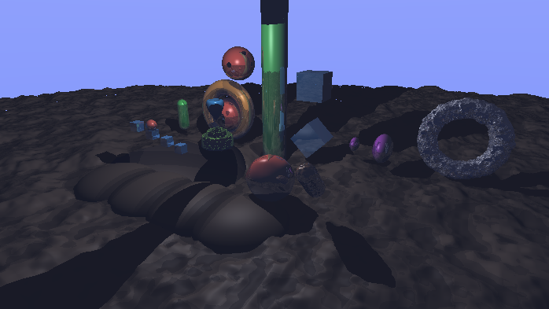
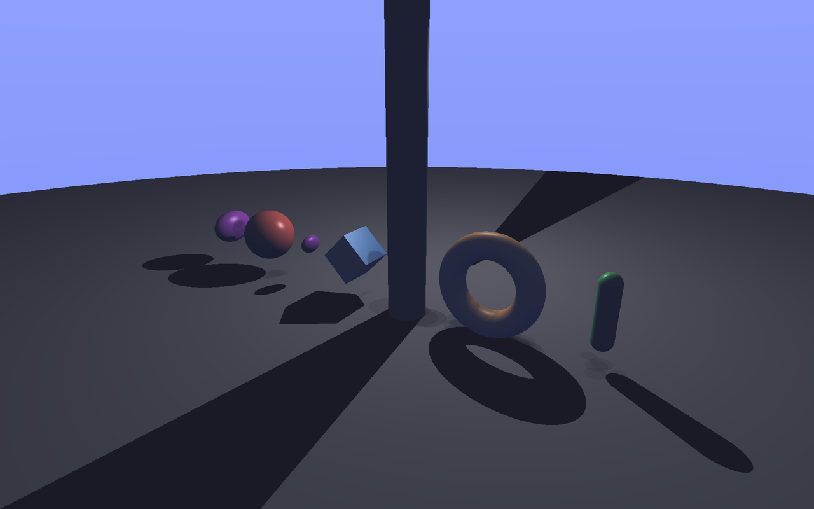
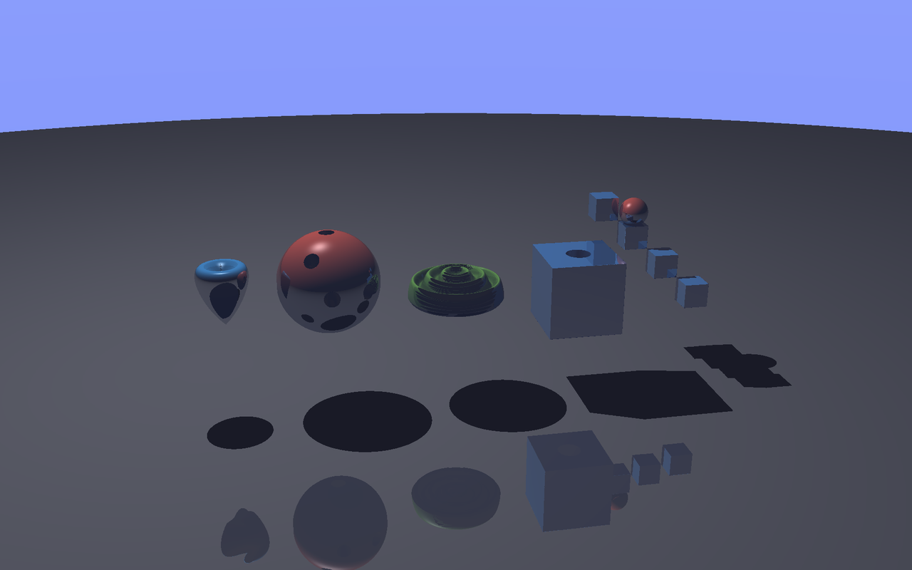
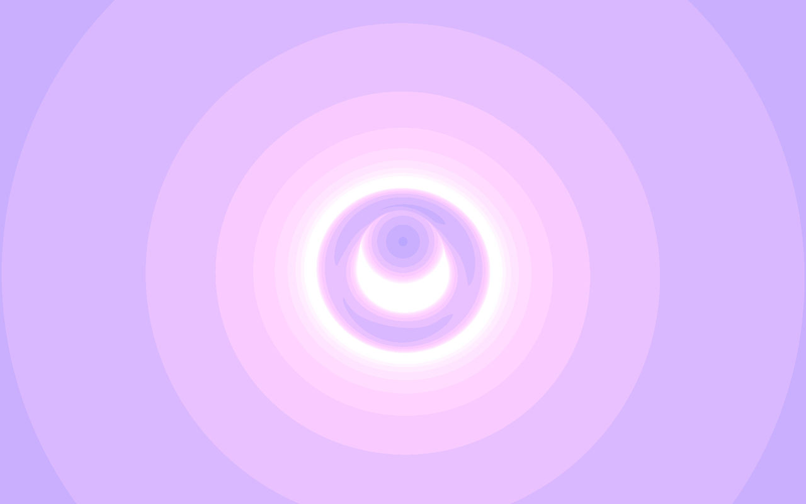
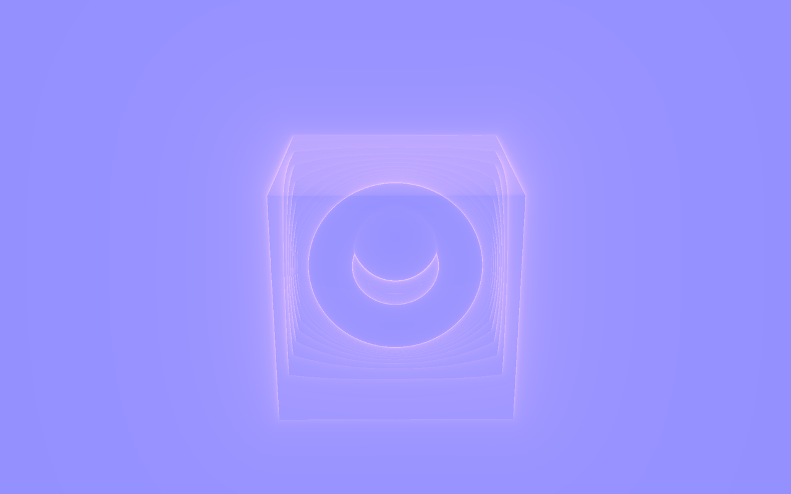

# SDF Raymarching Renderer

A real-time renderer written in GLSL that runs on Shadertoy. Every object
is described by a signed distance function (SDF) and rendered with sphere
tracing. There are no meshes and no triangles: the GPU evaluates the scene
for every pixel.

Built for the Computer Graphics course of my Master's degree in Computer
Science (Université Claude Bernard Lyon 1, 2025).



Run it in the browser: [main scene](https://www.shadertoy.com/view/WX2fDW) ·
[bounding volume experiment](https://www.shadertoy.com/view/33jBWD)

The full scene is GPU-heavy (see [Performance](#performance-and-bounding-volumes)).
Keep the preview small rather than fullscreen, or set `SCENE` to `1` for a
lighter scene.

## Features

**Modeling**
- Primitives: sphere, plane, box, ellipsoid, cylinder, capsule, torus
- Constructive solid geometry: union, intersection, difference, smooth difference
- Translation, rotation and scaling of the distance field
- Composite shapes: sphere drilled by cylinders, ridged shell, water drop, staircase
- Noise-based terrain with a cave and overhangs

**Procedural detail**
- Value noise and turbulence used to displace surfaces
- Marble and wood textures

**Lighting**
- Phong shading with directional or point light
- Hard shadows
- Ambient occlusion
- One-bounce reflections

| Primitives | Complex shapes |
|---|---|
|  |  |

## Performance and bounding volumes

The full scene has about 22 primitives and 35 to 40 nodes in its SDF tree.
It runs at around 10 FPS on my laptop, and around 50 FPS in the cost
visualization mode. Most of the time goes into turbulence noise and ambient
occlusion, since every ambient occlusion sample is a new raymarch.

To measure this, the renderer can display the evaluation cost of each
pixel instead of the shaded image. `bounding_volumes.glsl` uses this to
test a common optimization: wrapping an expensive object in a cheap box.
Outside the box, only the box distance is evaluated. The full object is
evaluated only for rays that actually enter the box.

| Without bounding volume | With bounding volume | With bounding volume (scale ×10) |
|---|---|---|
|  |  |  |

Without a bounding volume, every ray pays for the object at every step,
including rays that pass far away from it. With the box, that cost almost
disappears from the image and remains only around the object.

The next step would be to apply the same technique to the main scene,
especially around the noisy objects.

## Project structure

```
shaders/
  main_scene.glsl        full renderer, all scenes and lighting
  bounding_volumes.glsl  cost heatmap with and without a bounding box
screenshots/
```

## Running it

1. Open [shadertoy.com/new](https://www.shadertoy.com/new).
2. Replace the default code with the content of one of the shaders.
3. Compile with Alt+Enter, then drag the mouse to orbit the camera.

Options at the top of `main_scene.glsl`:

| Define | Values |
|---|---|
| `SCENE` | `0` full scene, `1` primitives, `2` procedural textures, `3` complex shapes, `4` terrain |
| `POINT_LIGHT` | `0` directional light, `1` point light |
| `VIEW` | `0` shaded image, `1` number of steps per pixel, `2` evaluation cost per pixel |

## Credits

The starting template (camera, sphere tracing loop, normal estimation) was
provided by Eric Galin for the course. The primitives, operators, noise,
textures, lighting, scenes and bounding volume experiment are my own work.
